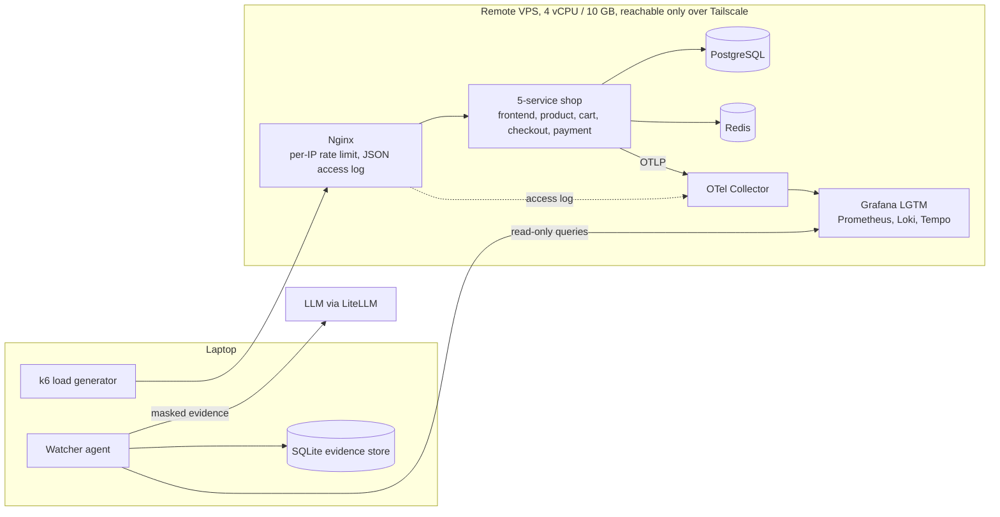

# Watcher

**A read-only LLM agent that triages e-commerce alerts.** When traffic spikes, it decides from evidence whether the cause is an **attack**, a **legitimate marketing campaign**, or an **operational failure** such as a bad deploy. It then writes an on-call report in which every claim cites an evidence ID.

The agent never touches the system: no restarts, no rollbacks, no config changes, no blocking. It explains, separates, proves, and recommends. A human decides.

> Project documents (`docs/`, `AGENTS.md`) and the reports are in Turkish, the on-call team's language. Code identifiers are in English.

## Why

The first minutes of an alert are spent jumping between dashboards. A 5× traffic spike can be a flash sale or a flood, and both wrong calls are expensive. Block a campaign and you lose sales. Wave through an attack and the site goes down. Watcher collects the signals that separate the cases and puts them in one cited report.

## Architecture



**Lab on a remote VPS**
- Docker Compose runs on the VPS and is driven from the laptop through a Docker context, so nothing is bind-mounted and the config files are baked into the images.
- Everything, Nginx included, listens only on the VPS's Tailscale IP. Docker port publishing bypasses ufw, so binding to `0.0.0.0` is never used. Server IPs live only in `.env`.
- Grafana's anonymous role is a read-only `Viewer`. The agent queries Prometheus, Loki and Tempo only through Grafana's datasource proxy with that role.

**Shop and telemetry**
- One Python/FastAPI codebase and one image run as 5 containers; the `SERVICE` variable picks the role.
- A payment request produces a single trace across all 5 services, Postgres and Redis.
- An OpenTelemetry Collector ships the Nginx JSON access log and host/container metrics.
- Business counters (orders, page views, payments), deploy markers (Grafana annotations with service and version tags) and a campaign calendar give the agent context.

## How the agent works

1. **Trigger:** CLI call with an `incident_id` and a time window (run start → alarm).
2. **Collect:** about 46 read-only queries yield 13 evidence items in about 7 seconds:
   - request rate and status mix
   - per-client concentration, and pages, 429s and sessions for the top clients
   - funnel and conversion, orders
   - application errors with exception types
   - p95 latency, error traces
   - deploy markers, active campaigns

   Each item gets an `evidence_id` (E01…E13) in SQLite. A source that does not answer is recorded as `unreachable`, never silently skipped.
3. **Protect:** client IPs are replaced with aliases (`client-1`) before anything reaches the LLM. Log excerpts are truncated, IP-masked, and marked as untrusted data whose instructions must not be followed.
4. **Classify and report:** one LLM call returns a verdict plus impact, timeline, supported and rejected hypotheses, "what could mislead me", missing evidence, and next steps. Code then validates the answer:
   - Any claim citing a missing or unreachable evidence ID is dropped.
   - A verdict without valid evidence becomes `unknown`. Abstaining is a valid answer.
5. **Output:** `agent/reports/<incident_id>.json` and `.md`, plus metadata: queries, tokens, duration.

## Scenarios

Each run is 30 minutes: 10 minutes of normal traffic, 15 minutes of incident, 5 minutes of recovery. The alarm fires 2 minutes into the incident.

| Scenario | Label | What happens |
|---|---|---|
| `campaign-flash-sale-01` | `legit_campaign` | Calendar campaign; ~5× traffic from many IPs, full funnel |
| `attack-homepage-flood-01` | `attack` | Single-IP L7 flood on `/` only (~10×), no cookies; not a DDoS |
| `campaign-rate-limit-01` | `legit_campaign` | Campaign traffic behind 2 carrier-NAT IPs hits the rate limit (429). The trap scenario: it must not look like an attack |
| `ops-checkout-deploy-01` | `ops_failure` | checkout v1.1.0 breaks multi-item carts with a `KeyError`; ~30% of checkouts return 500 |

## Evaluation

- Ground-truth labels were committed **before** any run, and each run record stores that commit.
- 4 scenarios × 3 repetitions = 12 runs. The 3rd repetition of every scenario (4 runs, 33%) is the **holdout**: its telemetry was not inspected during development, and it was scored exactly once.
- `incident_id` reveals nothing about the scenario. The agent reads neither ground truth nor run records; only the evaluation script maps incidents to labels.

Model: `deepseek/deepseek-v4.1-flash-1017` via OpenRouter, single call.

| Set | Correct | Macro-F1 | Citation validity | Time / incident | Cost / incident |
|---|---|---|---|---|---|
| Development (r1, r2) | 8/8 | 1.000 | 100% | ~27 s | < $0.01 |
| Holdout (r3, scored once) | 3/4 | 0.778 | 100% | ~31 s | < $0.01 |

Full tables: [`agent/eval/dev.md`](agent/eval/dev.md), [`agent/eval/holdout.md`](agent/eval/holdout.md). Cost is estimated from OpenRouter list prices, because LiteLLM does not know this model's price yet.

**The one miss.** The holdout run of the NAT campaign was called an `attack`. Its evidence was nearly identical to the two development runs, which were classified correctly with medium confidence. The error comes from an unstable verdict, not from missing evidence. The prompt was **not** tuned on the holdout result.

### Example report (translated excerpt)

From [`agent/reports/inc-2ef0e0db.md`](agent/reports/inc-2ef0e0db.md), the faulty-deploy scenario:

> **Verdict: operational failure, high confidence.** checkout v1.1.0 was deployed 103 s before the alarm; checkout `KeyError`s and 500s follow, while traffic is normal, so this is neither an attack nor a campaign. [E12, E09, E11, E08]
>
> **Impact:** orders/min fell from 4.4 to 2.4, conversion from 4.9% to 2.8%. [E08, E07]
> **Rejected:** attack (traffic 1.0×, no 429s) [E01, E06]; campaign (nothing on the calendar) [E13].
> **Next step (human decides):** evaluate a rollback or hotfix for checkout v1.1.0.

## Known limitations

These come from my own error analysis and drive the next steps.

- **Calendar reliance.** Correct campaign verdicts lean on the campaign calendar. The strongest NAT signal, hundreds of sessions and real checkouts behind one IP, is underused. No scenario yet has an attack during a campaign or a calendar entry that brings no traffic.
- **Confidence is not calibrated.** No report so far says `low` or `unknown`, and the wrong holdout verdict had the same confidence as the correct ones.
- **Small numbers.** The 2-minute incident window holds only a few checkouts. The deploy verdict rests on a handful of 500s plus the deploy marker and stack trace.
- **Evidence bugs.** One payment figure is a 2-minute total with no unit, and some reports read it as per-minute. Conversion is diluted by the attacker's non-429 requests during a flood.
- **Not built yet:** Telegram delivery, the full tool-using agent, a rules-only baseline for comparison, and log-injection tests.

## Repository layout

| Path | Contents |
|---|---|
| `agent/` | `telemetry.py` (evidence collection), `store.py` (SQLite), `classify.py` (prompt and output validation), `report.py`, `investigate.py` (CLI), `evaluate.py` |
| `lab/` | Docker Compose, Nginx, the shop (`lab/app/shop/`), OTel Collector, `deploy.py` (deploys a version and writes a Grafana marker) |
| `loadgen/` | k6 script: normal shoppers, campaign, NAT campaign, flood |
| `scenarios/` | Ground truth, `runner.py`, campaign calendar, run records (`runs/`) |
| `tests/` | 49 unit tests (lab responses recorded from development runs) and 37 end-to-end tests against the live lab |
| `docs/PROJECT_CONTEXT.md` | Decisions, scope, calibration notes (Turkish) |

## Running it

```bash
uv sync
docker --context default compose -f lab/compose.test.yaml up -d   # local Postgres + Redis for unit tests
uv run pytest                                                      # e2e tests skip without .env

# Needs .env with LAB_BIND_IP, LLM_MODEL (LiteLLM format) and LLM_API_KEY; see .env.example
uv run --env-file .env python agent/investigate.py <incident_id> --start <window start> --end <alarm time>
uv run --env-file .env python agent/evaluate.py    # development set → agent/eval/dev.md
uv run --env-file .env pytest tests/e2e            # live lab + real LLM
```

The lab itself runs on a VPS behind Tailscale: `docker --context <vps> compose -f lab/compose.yaml --env-file .env up -d --build`. See `AGENTS.md` for all commands.

## Stack

Python 3.12, FastAPI, PostgreSQL, Redis, Nginx, Docker Compose, OpenTelemetry, Grafana LGTM (Prometheus, Loki, Tempo), k6, LiteLLM, SQLite, Tailscale, pytest, ruff, uv.
